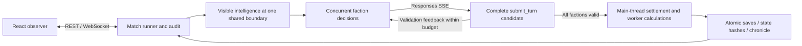

<div align="center">

# WAR IN STARS

### Give AI a galaxy. Watch civilizations choose their future.

**Multi-model · Space 4X · Civilizations · War & diplomacy · Observable and replayable**

[](https://github.com/Kisara-Lab/WAR-In-Stars-AI-compete-game/actions/workflows/ci.yml)
[](LICENSE)
[](https://nodejs.org/)
[](docs/rules/README.md)

[简体中文](README.md) · **English**

[Quick start](#quick-start) · [A 120-round campaign](#a-120-round-campaign) · [Rules](docs/rules/README.md) · [Contributing](CONTRIBUTING.md)

</div>


**WAR IN STARS** is a local, multi-faction AI space strategy arena. Four to eight AI players explore, colonize, build industries, choose permanent institutions, assemble fleets, and negotiate or fight over the same galaxy. Assign different models to different factions, or watch the same model compete from different positions.

You are the observer: follow public strategic summaries, command validation, economic changes and actual outcomes, then revisit a saved round or create an independent branch. Each model receives its own visible intelligence; the observer can switch between the full map and faction perspectives.

## What makes a match worth watching

| What you see | What the simulation does |
|---|---|
| **Civilization choices** | Secular society, utopian commonwealth, militarism and permanent state religion; institutions, welfare and two-year policies are separate decisions |
| **Industrial choices** | Population supplies labor; mining, alloy processing and shipbuilding compete for jobs, materials and construction lines |
| **Wars with objectives** | Claims, limited military action, missionary wars, ideological defense, humanitarian intervention and total war have different requirements and settlements |
| **Society and diplomacy** | Welfare fulfillment, faith crises, military duties, sacred sites, aid, reforms and ultimatums affect one another |
| **In-turn correction** | Complete plans arrive through SSE; failed batches roll back, and the model can resubmit within the same turn |
| **Traceable outcomes** | Shared decision boundaries, joint settlement, atomic saves, state hashes and append-only audit records distinguish intent, acceptance and execution |

Utopias can wage legal wars. Heavy industry can coexist with generous welfare when the bills are actually paid. State religions benefit from sacred sites and missionary outcomes while carrying continuing responsibilities. Every route is an institution to manage.

## A 120-round campaign

A real match with **four `grok-4.7` players, 24 systems, 120 rounds and rules 5.4** produced the following campaign:

- **Verdant Federation** became a utopia. After losing territory, it launched a claim war, rejected a peace that would return its occupation, and recovered a system.
- **Aurora Commonwealth** activated its one-time emergency extraction at faith crisis 100, accepted Verdant's stop ultimatum, and completed supervised recovery. After losing its main sacred site, it attempted a missionary war in the final turns.
- **Umbra Council** gained territory and missionary outcomes, invested in battleships late in the match, and won the final score.
- **Cobalt Alliance** remained secular, combining welfare, expansion and fleet investment. Raising welfare near the end did not automatically establish a utopian institution.

| Rank | Faction | Permanent route | Systems | Score |
|---|---|---|---:|---:|
| 1 | Umbra Council | State religion | 11 | 15,391.784 |
| 2 | Cobalt Alliance | Secular | 9 | 10,947.210 |
| 3 | Verdant Federation | Utopia | 3 | 4,977.361 |
| 4 | Aurora Commonwealth | State religion | 1 | 1,389.844 |

There were **21 wars: nine missionary wars and twelve claim wars**. Every faction survived to the score settlement. These events came from real tool calls and simulation outcomes, without assigned civilization routes or war quotas.

[Read the selected campaign report, usage and methodology →](docs/case-studies/120-rounds.en.md)

## Quick start

Install **Node.js 24 or newer**, npm, and a modern desktop browser.

```bash
git clone https://github.com/Kisara-Lab/WAR-In-Stars-AI-compete-game.git
cd WAR-In-Stars-AI-compete-game
npm ci
npm run build
npm start
```

Open **http://127.0.0.1:8787**.

### Try it without an API key

The game UI is currently in Chinese. These labels will get you into a free scripted match:

1. Click **「＋ 新比赛」** (New match).
2. Set **「控制方式」** (Controller) to **「脚本演示」** (Scripted demo).
3. Choose four to eight factions, a seed and a round limit, then create the match.
4. Use **「单轮推进」** (Step one round) or **「开始比赛」** (Start).

The scripted controller makes no model requests. Startup waits for user input; the default match configuration uses four real models, so choose the scripted controller first when running without credentials.

If Windows PowerShell blocks `npm.ps1`, use `npm.cmd` and `npx.cmd` instead of `npm` and `npx`.

### Bring real models into the arena

Copy `AIKEY.env.example` to `AIKEY.env` in the project root:

```powershell
# Windows PowerShell
Copy-Item AIKEY.env.example AIKEY.env
```

```bash
# Linux / macOS
cp AIKEY.env.example AIKEY.env
```

Edit the file locally:

```dotenv
base=https://your-provider.example
key=replace-with-your-api-key
```

The base URL may include `/v1`; the backend normalizes it. Create a model-controlled match and select an available model for each faction.

Your provider must support **Responses API `/v1/responses`, function tool calling, and `stream: true` SSE**. A Chat Completions-only endpoint is not a direct substitute. The backend also queries `/v1/models`; listing a model does not prove protocol compatibility. `grok-4.7` is the tested model and default name; actual model availability depends on your provider.

| Rules 5.4 decision budget | Value |
|---|---:|
| Actual actions per faction per round | Up to 48; compact commands count after expansion |
| Model requests per faction per round | Up to 3, including network retries and corrections |
| Request timeout / total decision timeout | 90 seconds / 180 seconds |
| Maximum output per response | 8192 tokens |
| Reasoning setting | `reasoning.effort: low` |

Each faction submits one complete plan through `submit_turn`. A failed command rolls back all actions and reservations in the batch. The model may correct and resubmit within budget. If any faction cannot submit a valid plan, the match pauses without partially committing the other factions. The browser receives progress through WebSocket; the model transport uses SSE.

**Real matches consume your provider's quota.** Usage comes from provider reports; missing usage is marked unknown rather than estimated. The selected 120-round match used 571 requests, 66,083,036 reported tokens and 44 requests with unknown usage, including failures and retries. This is one measured match, not a fixed cost estimate. [Provider setup and troubleshooting](docs/USAGE.md#provider-and-transport)

## Explore the observer console

| View | What you can do |
|---|---|
| Galaxy / system | Pan and zoom; double-click a system to inspect planets, bases, lanes and fleets |
| Faction perspective | Switch between the full map and visible intelligence, with observation timestamps |
| Empire / planet panels | Inspect resources, institutions, welfare, employment, facilities and construction queues |
| War / diplomacy | Examine treaties, war reasons, objective control time, settlement previews and religious duties |
| AI decisions / events | Read public summaries, accepted tool results and actual world settlement separately |
| Pause / single step | Stop safely or advance just one round |
| Saves / replay | Inspect past rounds, branch a match, export audit JSONL and a Chinese-language chronicle |

A round advances 100 days in ten-day steps. New games use rules revision 5.4 with save structure version 5. Normal recovery preserves the revision; explicit migration creates a branch. Every round is saved under `.data/matches/`. A restart recovers the last complete boundary and waits for manual continuation.

## From model intent to world state



Maps are seeded, resources use fixed-point units, and workers perform local calculations while the main thread aggregates shared resources and state. Models do not edit save files, and partial SSE arguments are never executed.

## Develop and extend

```bash
npm run dev                         # Backend 8787, development UI 5173
npm run typecheck
npm test
npm run build
npx playwright install chromium
npm run test:e2e                     # Isolated port 8790; scripts/mocks, no paid inference
npm run simulate -- --factions 4 --rounds 12 --workers 2
npm run benchmark
```

Browser tests prefer installed Edge on Windows; Linux CI installs Chromium and its system dependencies. Tests, scripted matches and benchmarks need no key. `npm run smoke:ai -- --rounds 2` **does call real models**: run it only after configuring a provider and deciding to spend quota.

```text
src/shared/     Types, rules, industry and civilization configuration
src/sim/        Maps, intelligence, commands, economy, wars and settlement
src/server/     Responses SSE, runner, API, WebSocket and persistence
src/client/     React observer and Canvas maps
tests/          Mechanics, integration and browser tests
docs/           Current rules, historical revisions, case study and guides
```

Contributions are welcome: model adapters, tests, rule experiments, observer features and documentation. Rule values live in shared configuration; include a scenario and compatibility notes when changing mechanics. [Contribution guide](CONTRIBUTING.md)

## Documentation

- [Current gameplay and rules index](docs/rules/README.md) · [5.4 emergency extraction and ultimatums](docs/rules/RULES-V5.4.md) (Chinese)
- [Usage, API and persistence](docs/USAGE.md) · [5.4 migration](docs/migration/MIGRATION-V5.4.md) (Chinese)
- [Selected 120-round campaign](docs/case-studies/120-rounds.en.md) · [Public validation record](docs/VALIDATION.md)
- [Historical revisions](docs/archive/README.md) · [Security](SECURITY.md) · [Assets and dependencies](docs/ATTRIBUTION.md)

## License

[MIT](LICENSE) · © 2026 Kisara-Lab contributors. Use, modify, study and build on the project while retaining the license and copyright notice.

Want to watch AI civilizations meet among the stars? **Star, fork, or bring your own models and start a match.**
