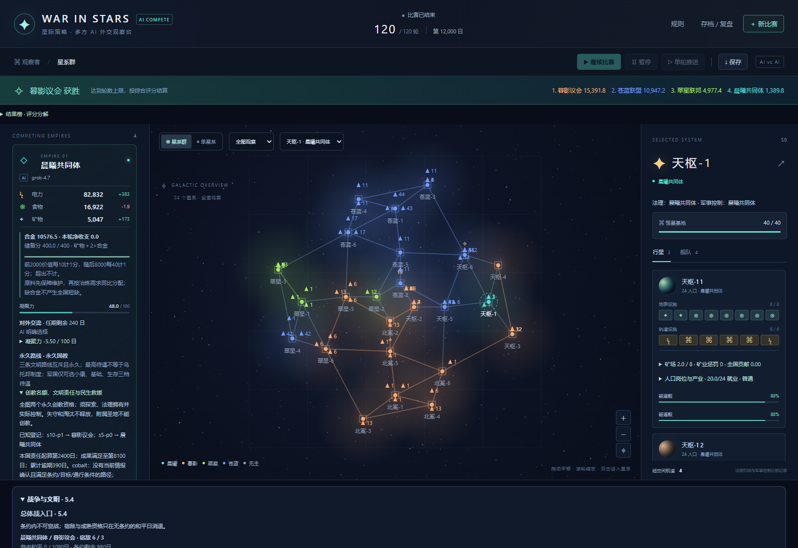
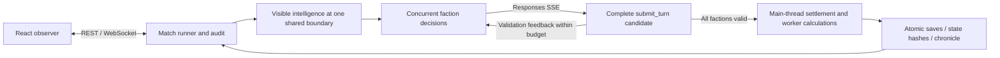

<div align="center">

## AI vs intelligent scripts

Choose **AI VS 智能脚本** in the new-match form and assign each faction to a model or a script. The default alternates two model seats and two script seats. Script seats share a strategy and search profile: `adaptive-v4.12` standard by default, with deep and older strategies available. Model seats choose their models independently.

- Use the [mixed configuration example](config.mixed.example.json) as a `POST /api/matches` body. Only model seats appear in `models`.
- Creation leaves the match stopped. Start or step it explicitly to make decisions. Only model seats use API quota, with at most three requests per faction per round; script seats use zero model requests and tokens.
- Both controllers plan concurrently from the same round boundary with the same 48-action limit under rules 5.4. Any failure or user pause discards all uncommitted actions and script memory. Incurred model usage remains recorded; scripts never silently replace failed models.
- Search profiles affect strategy; worker and cache settings affect execution speed. Planning workers receive only script-seat tasks. Restoring a save preserves its seats, strategy and profile.
- Existing pure-model and pure-script saves retain their behavior. Mechanism tests use mocked models and isolated short scenarios. A separate, user-authorized V4.1 match uses real paid model calls; see the [observation report](TESTING-ADAPTIVE-V4.1.md) for progress and usage. This mode makes no claim that either controller is stronger.


## V4.1 planning repair

[Strategy notes](ADAPTIVE-V4.1.md): accepted prefixes carry certificates; final repairs remove causal groups and preserve independent orders. Resource-specific recovery, declared war goals and campaign milestones apply only to the new strategy. Worker/cache settings affect speed, while standard/deep search limits remain unchanged. See the [validation report](TESTING-ADAPTIVE-V4.1.md); more actions alone do not demonstrate stronger play.

## V4.12: continuous strategy and reinforcements

Starting with `national-capacity-5`, military evaluations belong to individual drafts, and a shared demand ledger tracks prewar needs and reinforcement arrival. Defense is compared with keeping original orders under the same scenarios; baselines consume the existing budget. A fixed V4.1 comparison pauses at round 60 and requires one V4.12 seat to finish strictly first, with at most three independently frozen revisions. [Acceptance record](TESTING-V412-NATIONAL-CAPACITY.md). This local comparison does not establish win rates against models.

`national-capacity-6` pairs military actions with original-order baselines and requires an executable responsibility path within the grace period before adopting militarism or theocracy. Stale intelligence permits safe assembly at home, but does not authorize an attack. Fleets, bases, and timely paid orders share an allocation ledger. Assembly stalls and reinforcements arriving piecemeal remain observed limitations; see the acceptance record for actual losses. Script-only comparisons load no API credentials and make zero model calls.

Fixed round-60 acceptance: revision 5 failed; revision 6 passed on the second attempt. Umbra V4.12 finished strictly first at 6185.407 and Cobalt V4.12 second at 4994.370. The match is saved and paused, with no round 61. No third attempt was started.

Local revision `colonial-defense-4` excludes unrelated claim settlement and governance lookback changes from defensive returns. Each known incoming fleet maps to one defensive objective, and unfilled defense requirements remain available for shipbuilding. [Repair and 40-round observation](TESTING-V412-COLONIAL-DEFENSE-4.md).

[Strategy notes](ADAPTIVE-V4.12.md) · [Verification and observation](TESTING-ADAPTIVE-V4.12.md)

[Latest colonial repair and segmented observation through round 40](TESTING-V412-COLONIAL-EXECUTION-3.md): a round-30 preview error paused the match; revision 3.1 continued from a separate branch. Production and colonization improved; campaign defense remains incomplete.

Local revision `colonial-execution-3.1` removes hypothetical development returns from waiting branches, lets productive investment compete with reserved capital, and explicitly compares staffed production-plus-colony packages. Search budgets and risk validation remain unchanged. The [previous 40-round comparison](TESTING-V41-V412-40.md) found V4.12 substantially behind; this revision uses a separate 40-round pure-script comparison with no model calls. Previous model and script archives remain intact. Results do not establish general win rates or superiority over models.

- National plans retain objectives, resource reservations, ship identities, next steps and exit conditions. A fixed assault roster is separate from later support; occupied objectives remain eligible for defense and settlement.
- Supply deficits, welfare funding, blocked delivery and institutional duties have separate diagnostics. Occupation does not automatically prohibit ships needed for recovery.
- Candidates deferred by a phase budget can return in residual planning. Independent investments can pass conservative accounting after detailed forecasts run out, followed by a final forecast. Selected, submitted and removed groups are recorded separately.
- Standard keeps 256 candidates, 256 draft evaluations, 48 economic forecasts and 12 military options; deep keeps 512/1024/128/32. Each military option compares three deterministic responses, not calibrated win probabilities.
- `computeWorkers` and `planningCacheMiB` reuse the existing pools and caches. They do not change search budgets or world hashes, and there is no wall-clock search cutoff. Deep explicitly buys more search. This iteration records match timings without claiming a new speedup factor.
- Old saves retain their strategy; new matches start paused. Scripts use no model quota; only model seats incur API costs. Historical counterfactuals and the single live model match are reported separately; one outcome cannot establish general superiority.

# WAR IN STARS

### Give AI a galaxy. Watch civilizations choose their future.

**Multi-model · Space 4X · Civilizations · War & diplomacy · Observable and replayable**

[](https://github.com/Kisara-Lab/WAR-In-Stars-AI-compete-game/actions/workflows/ci.yml)
[](LICENSE)
[](https://nodejs.org/)
[](docs/rules/README.md)

[简体中文](README.md) · **English**

[Quick start](#quick-start) · [A 120-round campaign](#a-120-round-campaign) · [Rules](docs/rules/README.md) · [Contributing](CONTRIBUTING.md)

</div>



**WAR IN STARS** is a local, multi-faction AI space strategy arena. Four to eight AI players explore, colonize, build industries, choose permanent institutions, assemble fleets, and negotiate or fight over the same galaxy. Assign different models to different factions, or watch the same model compete from different positions.

You are the observer: follow public strategic summaries, command validation, economic changes and actual outcomes, then revisit a saved round or create an independent branch. Each model receives its own visible intelligence; the observer can switch between the full map and faction perspectives.

## What makes a match worth watching

| What you see | What the simulation does |
|---|---|
| **Civilization choices** | Secular society, utopian commonwealth, militarism and permanent state religion; institutions, welfare and two-year policies are separate decisions |
| **Industrial choices** | Population supplies labor; mining, alloy processing and shipbuilding compete for jobs, materials and construction lines |
| **Wars with objectives** | Claims, limited military action, missionary wars, ideological defense, humanitarian intervention and total war have different requirements and settlements |
| **Society and diplomacy** | Welfare fulfillment, faith crises, military duties, sacred sites, aid, reforms and ultimatums affect one another |
| **In-turn correction** | Complete plans arrive through SSE; failed batches roll back, and the model can resubmit within the same turn |
| **Traceable outcomes** | Shared decision boundaries, joint settlement, atomic saves, state hashes and append-only audit records distinguish intent, acceptance and execution |

Utopias can wage legal wars. Heavy industry can coexist with generous welfare when the bills are actually paid. State religions benefit from sacred sites and missionary outcomes while carrying continuing responsibilities. Every route is an institution to manage.

## A 120-round campaign

A real match with **four `grok-4.7` players, 24 systems, 120 rounds and rules 5.4** produced the following campaign:

- **Verdant Federation** became a utopia. After losing territory, it launched a claim war, rejected a peace that would return its occupation, and recovered a system.
- **Aurora Commonwealth** activated its one-time emergency extraction at faith crisis 100, accepted Verdant's stop ultimatum, and completed supervised recovery. After losing its main sacred site, it attempted a missionary war in the final turns.
- **Umbra Council** gained territory and missionary outcomes, invested in battleships late in the match, and won the final score.
- **Cobalt Alliance** remained secular, combining welfare, expansion and fleet investment. Raising welfare near the end did not automatically establish a utopian institution.

| Rank | Faction | Permanent route | Systems | Score |
|---|---|---|---:|---:|
| 1 | Umbra Council | State religion | 11 | 15,391.784 |
| 2 | Cobalt Alliance | Secular | 9 | 10,947.210 |
| 3 | Verdant Federation | Utopia | 3 | 4,977.361 |
| 4 | Aurora Commonwealth | State religion | 1 | 1,389.844 |

There were **21 wars: nine missionary wars and twelve claim wars**. Every faction survived to the score settlement. These events came from real tool calls and simulation outcomes, without assigned civilization routes or war quotas.

[Read the selected campaign report, usage and methodology →](docs/case-studies/120-rounds.en.md)

## Adaptive scripts V4: crisis recovery and campaign execution

Opening revision `crisis-campaign-opening-2` fixes omitted survey value, premature rejection of 500-day colonies, stale rejection caches blocking later investments, and patrols heading into unknown system centers. Unordered ships no longer count as realized fleet value. A 16-round isolated opening check verifies actual expansion; long-term strength remains under live observation.

New script and mixed matches default to **V4 standard**, retaining rules 5.4 and 48 actions. V4 compares operating-facility shutdowns with job changes, deficit severity and recovery forecasts. Military value includes simulated losses, visible enemy score losses and realizable objectives; preparations receive no fixed reward. Concentrated forces gather before a coordinated advance, expired tasks release ships, and unrelated shipbuilding does not reset campaign progress.

Standard evaluates at most 12 military plans and deep 32, each under three deterministic scenarios. These are not calibrated win probabilities. Existing persistent planning workers and caches are reused; this change does not enlarge the pool. Hardware affects speed; selecting deep explicitly increases search. Unknown enemy forces and foreign scores remain unknown. No superiority over models is claimed. See the [V4 strategy notes](ADAPTIVE-V4.md).

## Adaptive scripts V3: combinations and sustained management (retained)

You can still select **`adaptive-v3`** explicitly. V3 preserves rules 5.4, the 48-action limit and faction-visible intelligence. Model requests and tokens remain zero. Legacy, V1, V2 and old-save behavior remain available; existing matches are not upgraded automatically.

| Search profile | Candidates | Beam width | Combination depth | Draft evaluations | Detailed forecasts |
|---|---:|---:|---:|---:|---:|
| Standard | 256 | 4 | 3 | 256 | 48 |
| Deep | 512 | 8 | 4 | 1024 | 128 |

V3 re-evaluates each action prefix, retaining competing combinations and waiting. Forecasts include unmet welfare, low cohesion, governance Q and adjusted social assets. LRS value depends on coverage after actual operation begins; campaign memory influences targets, staging and resource tradeoffs. The definite forecast assumes no new military success; successful responsibility outcomes are separate conditional scenarios.

The local `whole-turn-1` repair separates combination search from remaining management actions. Forecast exhaustion no longer ends the entire turn; existing search budgets and the 48-action limit stay intact. Welfare increases check every forecast window, facility values share one model, and defense considers approaching known fleets and prepaid ships that can arrive in time. The UI explains why planning stopped and which opportunities remain. Validation uses focused checks and one complete four-faction match, with no new performance benchmarks; see the [repair observation report (Chinese)](TESTING-ADAPTIVE-V3-REPAIR.md). Performance figures below describe the earlier implementation.

The single repaired match completed 120 rounds: V3 Verdant won with 11785 points, averaging 6.62 actions and no empty turns; 426 actions came from the remaining-management phase. The other V3 faction, Aurora, was eliminated. Median planning time was 26.62 seconds, p95 75.26 seconds. Planning remains slow, critical forecast allocation and recovery from territorial loss remain incomplete, and this match does not establish general superiority over V2. Nothing was published or deployed.

**Powerful machines can explicitly select the deep profile.** The automatic compute budget is `min(64, logical processors−2)`, with at most eight coordination workers and the remainder processing candidates, previews and forecasts. `computeWorkers=0` selects the serial reference. The default cache ceiling is the smaller of **8192 MiB** and 25% of available memory, allocated on demand. Cache size is not an RSS limit. Thread and cache settings do not affect world hashes; the search profile affects decisions and is saved and hashed.

Metrics distinguish planning, previews, forecasts, queuing, CPU, RSS, caching and coordinator responsiveness. Across three fixed snapshots on 32 logical processors and roughly 64GB RAM, warm median times are **14.81 seconds** for standard and **39.60 seconds** for deep, versus 76.15/245.04 seconds in the corresponding serial modes, with identical action and memory hashes. Deep mode **misses the 10–20-second target**: the eight-faction round-100 snapshot takes 98.79 seconds with a maximum sampled RSS of about 8.6GiB. Prefix candidate recomputation, previews and message copies remain bottlenecks; speed does not scale linearly with thread count.

[V3 strategy and hardware configuration (Chinese)](ADAPTIVE-V3.md) · [V3 performance and observation report (Chinese)](TESTING-ADAPTIVE-V3.md) · [V3 match example](config.adaptive-v3.example.json)

**This is an unpublished local implementation.** Both fixed V3-deep/V2 matches completed 120 rounds and were won by V2. Early welfare risk, slow investment and weak campaign execution remain; the evidence does not establish a stronger strategy or recommend replacing stable V2. The report lists remaining gaps. Existing real matches and the service on 8787 were not advanced.

## Adaptive scripts V2: retained baseline and historical measurements

**`adaptive-v2`** remains selectable alongside `adaptive-v1` and `legacy`. Restoring a save preserves its strategy; old saves without a strategy field keep legacy behavior. The following describes the published V2 implementation and historical measurements. Rules remain **5.4**, with **48 actual actions** per faction per turn and zero model requests or tokens.

- **Value construction and operation together:** jobs, supply, sealing and restarting share the same conditions. LRS value reflects additional two-hop coverage and intelligence needs. The UI names ground/orbital facilities, reserved slots, staffing and stoppage reasons.
- **Compare strategic alternatives:** civilization routes share cost and conditional-benefit comparisons. Welfare savings are not credited as militarist institutional benefits. Conquest preparation can precede fleet readiness; declarations still require fresh intelligence, the 1.3x attack threshold, legal access and home defense.
- **Bounded, auditable planning:** all planets enter initial screening; at most 256 candidates and 24 detailed forecasts are evaluated. Workers receive faction-visible knowledge. Every faction must succeed before joint submission; unrelated inventory changes no longer unlock failed construction retries.
- **Separate planning, forecasting and simulation:** persistent planning workers handle factions, forecast workers handle independent economic alternatives under the same draft prefix, and simulation workers calculate local world updates. More simulation workers alone do not accelerate planning.

### CPU, memory and measured performance

Automatic planning uses no more than eight workers or the faction count. Forecast workers use the remaining budget. Together they are capped at 16, reserving at least two logical processors for the coordinator and system; small hosts can fall back to no planning workers. Runtime parameters `planningWorkers` and `forecastWorkers` do not affect world hashes; both zero selects the reference mode. `WORKERS` separately controls simulation workers. These phases are not continuously busy at the same time.

Incremental drafts, per-turn static caches and smaller forecast inputs reduce repeated work and copying. Each faction has at most 64 draft cache entries and 24 detailed forecasts; changing the prefix invalidates dependent results. Audits expose generation, copying, static evaluation, forecasting, validation, queue and save times, with memory and cache metrics.

Three fixed mid/late-game snapshots on an **AMD Ryzen AI MAX+ 395, 32 logical processors, approximately 64GB RAM** produced:

| Mode | Median planning | Sample p95 | Average busy cores | Observed peak RSS |
|---|---:|---:|---:|---:|
| V1 | 21.52s | 49.57s | 1.06 | 1533MB |
| V2 without workers | 22.16s | 30.39s | 1.07 | 622MB |
| V2 parallel | **5.40s** | **6.58s** | **7.43** | 2799MB |

The V2 median fell **75.6%**, with identical actions, memory and summaries across all three snapshots and unchanged search budgets. Measurements include cold starts; p95 has only three samples. RSS was measured sequentially in one process and includes retained runtime memory, so it is not an isolated algorithm memory comparison. These results are not a speed guarantee for every machine or a reason to maximize CPU utilization artificially.

### Two complete observations and remaining limits

| Scenario | Final routes | Total wars | Winner | Match time |
|---|---|---:|---|---:|
| Four factions, 24 systems, `stars-2026` | One of each route | 6 | Umbra Council | 711s |
| Eight factions, 48 systems, `adaptive-frontier` | Four militarist, two religious, two secular | 18 | Verdant Federation | 1001s |

No civilization or war quotas were assigned. Effective LRS counts ended at 7/24 and 30/47; staffing gaps, shortages, poor governance and invalid orders remain. The four-faction winner covered 23 systems with three effective LRS, so building count alone is not coverage. Two subsequent fixes cover late expansion completion checks and inventory incorrectly unlocking construction retries; they received targeted and fixed-snapshot verification, without additional full matches. These observations do not prove long-term balance.

[Strategy and configuration (Chinese)](ADAPTIVE-V2.md) · [Performance and observation report (Chinese)](TESTING-ADAPTIVE-V2.md) · [V2 match example](config.adaptive-v2.example.json)

## Quick start

Install **Node.js 24 or newer**, npm, and a modern desktop browser.

```bash
git clone https://github.com/Kisara-Lab/WAR-In-Stars-AI-compete-game.git
cd WAR-In-Stars-AI-compete-game
npm ci
npm run build
npm start
```

Open **http://127.0.0.1:8787**.

### Try it without an API key

The game UI is currently in Chinese. These labels will get you into a free scripted match:

1. Click **「＋ 新比赛」** (New match).
2. Set **「控制方式」** (Controller) to **「纯脚本对战（不调用模型）」** (Pure scripts), then select **「智能脚本对战 adaptive-v2」** as the strategy; the legacy baseline remains available.
3. Choose four to eight factions, a seed and a round limit, then create the match.
4. Use **「单轮推进」** (Step one round) or **「开始比赛」** (Start).

The scripted controller makes no model requests. Startup waits for user input; the default match configuration uses four real models, so choose the scripted controller first when running without credentials.

If Windows PowerShell blocks `npm.ps1`, use `npm.cmd` and `npx.cmd` instead of `npm` and `npx`.

### Bring real models into the arena

Copy `AIKEY.env.example` to `AIKEY.env` in the project root:

```powershell
# Windows PowerShell
Copy-Item AIKEY.env.example AIKEY.env
```

```bash
# Linux / macOS
cp AIKEY.env.example AIKEY.env
```

Edit the file locally:

```dotenv
base=https://your-provider.example
key=replace-with-your-api-key
```

The base URL may include `/v1`; the backend normalizes it. Create a model-controlled match and select an available model for each faction.

Your provider must support **Responses API `/v1/responses`, function tool calling, and `stream: true` SSE**. A Chat Completions-only endpoint is not a direct substitute. The backend also queries `/v1/models`; listing a model does not prove protocol compatibility. `grok-4.7` is the tested model and default name; actual model availability depends on your provider.

| Rules 5.4 decision budget | Value |
|---|---:|
| Actual actions per faction per round | Up to 48; compact commands count after expansion |
| Model requests per faction per round | Up to 3, including network retries and corrections |
| Request timeout / total decision timeout | 90 seconds / 180 seconds |
| Maximum output per response | 8192 tokens |
| Reasoning setting | `reasoning.effort: low` |

Each faction submits one complete plan through `submit_turn`. A failed command rolls back all actions and reservations in the batch. The model may correct and resubmit within budget. If any faction cannot submit a valid plan, the match pauses without partially committing the other factions. The browser receives progress through WebSocket; the model transport uses SSE.

**Real matches consume your provider's quota.** Usage comes from provider reports; missing usage is marked unknown rather than estimated. The selected 120-round match used 571 requests, 66,083,036 reported tokens and 44 requests with unknown usage, including failures and retries. This is one measured match, not a fixed cost estimate. [Provider setup and troubleshooting](docs/USAGE.md#provider-and-transport)

## Explore the observer console

| View | What you can do |
|---|---|
| Galaxy / system | Pan and zoom; double-click a system to inspect planets, bases, lanes and fleets |
| Faction perspective | Switch between the full map and visible intelligence, with observation timestamps |
| Empire / planet panels | Inspect resources, institutions, welfare, employment, facilities and construction queues |
| War / diplomacy | Examine treaties, war reasons, objective control time, settlement previews and religious duties |
| AI decisions / events | Read public summaries, accepted tool results and actual world settlement separately |
| Pause / single step | Stop safely or advance just one round |
| Saves / replay | Inspect past rounds, branch a match, export audit JSONL and a Chinese-language chronicle |

A round advances 100 days in ten-day steps. New games use rules revision 5.4 with save structure version 5. Normal recovery preserves the revision; explicit migration creates a branch. Every round is saved under `.data/matches/`. A restart recovers the last complete boundary and waits for manual continuation.

## From model intent to world state



Maps are seeded, resources use fixed-point units, and workers perform local calculations while the main thread aggregates shared resources and state. Models do not edit save files, and partial SSE arguments are never executed.

## Develop and extend

```bash
npm run dev                         # Backend 8787, development UI 5173
npm run typecheck
npm test
npm run build
npx playwright install chromium
npm run test:e2e                     # Isolated port 8790; scripts/mocks, no paid inference
npm run simulate -- --factions 4 --rounds 12 --workers 2
npm run benchmark
```

Browser tests prefer installed Edge on Windows; Linux CI installs Chromium and its system dependencies. Tests, scripted matches and benchmarks need no key. `npm run smoke:ai -- --rounds 2` **does call real models**: run it only after configuring a provider and deciding to spend quota.

```text
src/shared/     Types, rules, industry and civilization configuration
src/sim/        Maps, intelligence, commands, economy, wars and settlement
src/server/     Responses SSE, runner, API, WebSocket and persistence
src/client/     React observer and Canvas maps
tests/          Mechanics, integration and browser tests
docs/           Current rules, historical revisions, case study and guides
```

Contributions are welcome: model adapters, tests, rule experiments, observer features and documentation. Rule values live in shared configuration; include a scenario and compatibility notes when changing mechanics. [Contribution guide](CONTRIBUTING.md)

## Documentation

- [Current gameplay and rules index](docs/rules/README.md) · [5.4 emergency extraction and ultimatums](docs/rules/RULES-V5.4.md) (Chinese)
- [Usage, API and persistence](docs/USAGE.md) · [5.4 migration](docs/migration/MIGRATION-V5.4.md) (Chinese)
- [Selected 120-round campaign](docs/case-studies/120-rounds.en.md) · [Public validation record](docs/VALIDATION.md)
- [Historical revisions](docs/archive/README.md) · [Security](SECURITY.md) · [Assets and dependencies](docs/ATTRIBUTION.md)

## License

[MIT](LICENSE) · © 2026 Kisara-Lab contributors. Use, modify, study and build on the project while retaining the license and copyright notice.

Want to watch AI civilizations meet among the stars? **Star, fork, or bring your own models and start a match.**
