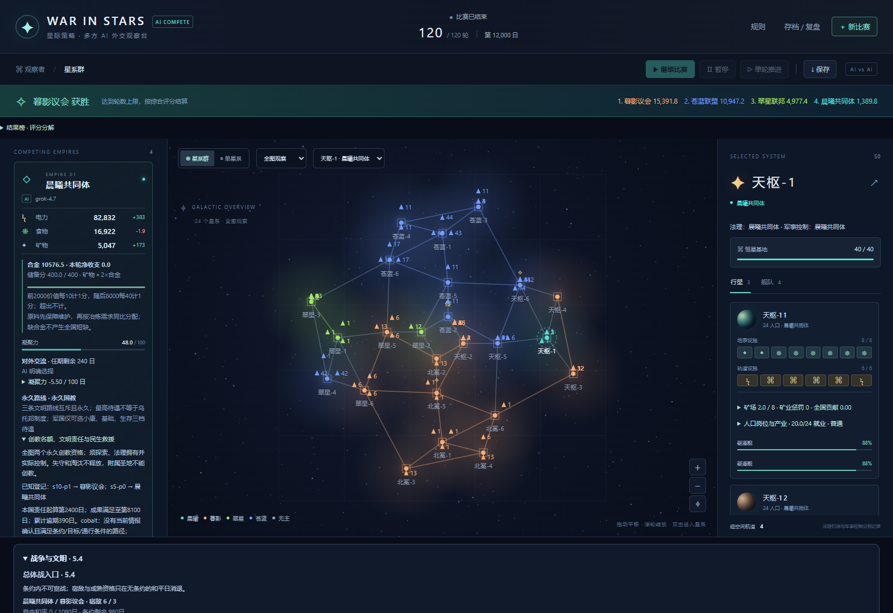
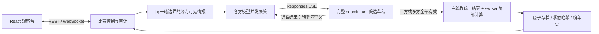

<div align="center">

## AI VS 智能脚本

新比赛选择“AI VS 智能脚本”，即可逐势力选择模型或脚本，默认交错两模型、两脚本。脚本方共用策略，默认 `adaptive-v4.12` 标准档，也可选择深度档或旧策略；模型方可分别选择模型。

- [混合局配置示例](config.mixed.example.json) 可作为 `POST /api/matches` 请求体；`models` 只填写模型席位。
- 创建后保持停止，点击“开始比赛”或“单轮推进”才决策。仅模型席位消耗接口额度，每方每轮最多3次请求；脚本席位请求和token始终为0。
- 模型与脚本基于同一轮边界并行决策，5.4下均为48条实际动作上限。任一方失败或用户暂停，整轮未提交动作和脚本记忆丢弃；已发生模型请求仍计费，不自动改用脚本补位。
- 搜索档位影响脚本策略；计算线程和缓存只影响运行速度。规划池仅为脚本席位分配任务，存档恢复保留原席位、策略及档位。
- 旧纯模型、纯脚本存档不自动切换模式。机制验证使用模拟模型及隔离短场景；另有用户授权的V4.1真实模型对战，进展和成本记录见[观察报告](TESTING-ADAPTIVE-V4.1.md)。模式本身不保证脚本或模型更强。


## V4.1 规划修复

[策略说明](ADAPTIVE-V4.1.md)：已验证动作前缀绑定证书，最终逐组修复，不再因后续投资风险把整轮归零。缺口定向经营、战争目标绑定和里程碑检查仅用于新版策略。线程和缓存只影响速度；标准/深度搜索上限不变。实际表现见[验证报告](TESTING-ADAPTIVE-V4.1.md)，不以动作数增加代替能力验收。

## V4.12 持续战略与二次支援

`national-capacity-5` 开始重构分支军事评估、战前需求与军备到达账；防御与保持原命令作同情景对照，基线计入原预算。固定V4.1对照在60轮暂停，要求V4.12一席严格第一，最多三次独立修订验证。[验收记录](TESTING-V412-NATIONAL-CAPACITY.md)。这是本地固定对照门槛，不是对模型胜率承诺。

`national-capacity-6` 将军事行动与原命令基线成对比较，并要求军国／国教承诺具备宽限期内可执行的责任路径。陈旧情报允许安全本土集结，但不能直接放行攻击；现役舰队、基地和及时完成订单使用统一分配账。仍可能出现集结停滞和增援分批接敌，详见验收记录的实际战损与局限。纯脚本对照不加载接口密钥，模型调用为0。

固定60轮验收：第一次修订5失败；第二次修订6通过，暮影V4.12为6185.407分严格第一，苍蓝V4.12为4994.370分第二。比赛已保存暂停，没有第61轮，不再追加第三次尝试。

本地修订 `colonial-defense-4` 修正防御收益混入无关宣称结算及治理窗口变化的问题；每支已知来袭舰队只对应一个防御目标，缺少可达舰队时仍保留补强需求。[修复与40轮观察](TESTING-V412-COLONIAL-DEFENSE-4.md)。

[V4.12 说明](ADAPTIVE-V4.12.md) · [验收与观察记录](TESTING-ADAPTIVE-V4.12.md)

[最新殖民兑现修复与分段40轮结果](TESTING-V412-COLONIAL-EXECUTION-3.md)：第30轮预演异常后暂停，修复3.1在独立分支续验至40轮；生产与殖民改善，战役防御仍有缺陷。

本地修订 `colonial-execution-3.1` 修复殖民储资与执行估值冲突：未下单的开发潜力不再给等待分支加分，基础生产可与储资竞争，并直接比较有岗位保障的生产＋殖民组合。保留原搜索预算和风险校验。[前次40轮对照](TESTING-V41-V412-40.md)确认V4.12仍明显落后；本修订使用独立纯脚本40轮对照验证，不调用模型，旧模型局与旧对照存档均保留。结果不代表普遍胜率或已胜过模型。

- 国家计划保留目标、预算、舰船身份、下一步和退出条件；首攻名单与二次支援分开，已占领目标继续比较守备和兑现。
- 分开诊断基础供应、福利资金不足、占领交付阻断及制度责任。被占领造成的福利缺口不再直接禁止收复所需造舰。
- 预算暂缓项可进入后续经营。详细额度不足时，独立经营先做保守收支检查，再由最终预测校验；阶段选择、实际提交与被移除组分别记录。
- 标准档仍为256候选、256草稿、48经济预测、12军事方案；深度为512、1024、128、32。每个军事方案比较三个确定反应情景，不将其解释为胜率。
- `computeWorkers` 与 `planningCacheMiB` 复用现有线程池和缓存；不提高搜索额度、不按耗时截断，不改变世界哈希。深度档显式增加搜索量；本次仅记录实战耗时，不宣称新的性能倍数。
- 旧局保持原策略；新局创建后暂停。脚本模型费用为0，混合局仅模型席位发生真实调用费用。关键短序列与唯一真实模型局分别报告，单局结果不证明普遍胜过模型。

# WAR IN STARS

### 把星海交给 AI，看文明如何选择自己的命运。

**多模型 · 太空 4X · 文明经营 · 战争外交 · 全程可观察与复盘**

[](https://github.com/Kisara-Lab/WAR-In-Stars-AI-compete-game/actions/workflows/ci.yml)
[](LICENSE)
[](https://nodejs.org/)
[](docs/rules/README.md)

**简体中文** · [English](README.en.md)

[快速开始](#快速开始) · [120轮真实赛](#一场120轮的星际史) · [玩法与规则](docs/rules/README.md) · [参与开发](CONTRIBUTING.md)

</div>



**WAR IN STARS** 是一个运行在本机的多方 AI 太空策略竞技场。4～8 个 AI 在同一片星图中探索、殖民、经营产业、选择文明制度、建设舰队并展开外交与战争。你可以为各方选择不同模型，也可以让同一模型在不同处境下彼此竞争。

人类坐在观察席：看见每个文明的公开战略、命令校验、经济变化与实际战果，再回到任何已保存轮次复盘或创建分支。模型只获得本方可见情报，观察者则可以切换全图与势力视角。

## 为什么值得看一局

| 你看到的 | 游戏里真正发生的 |
|---|---|
| **文明选择** | 普通世俗、乌托邦共同体、军国主义、永久国教；永久路线、民众待遇与两年政策分别决策 |
| **产业取舍** | 每人口提供劳动力；采矿—冶炼—造舰需要岗位、材料和施工线，空槽不等于免费产能 |
| **战争目的** | 宣称割让、有限军事、传教、思潮防卫、民生救援与总体战，各自有合法理由、目标与战后结果 |
| **社会与外交** | 福利兑现、信仰危机、军事责任、圣地争夺、援助、改革协议和停止通牒相互影响 |
| **模型临场纠错** | SSE 接收完整计划，失败批次全部回滚，模型在同一轮拿到错误后重新提交 |
| **可追溯比赛** | 同轮边界决策、统一结算、原子存档、状态哈希与追加审计，区分“想做”“接受”“发生” |

乌托邦可以发动合法战争。重工业可以与高福利并存，但必须真的支付账单。国教可以凭圣地与传教获得收益，也必须面对信仰责任。每条路线都是一套需要经营的制度。

## 一场120轮的星际史

一次真实的 **四方 `grok-4.7`、24星系、120轮、规则5.4** 比赛，最终形成了这样的故事：

- **翠星联邦**成为乌托邦。失地之后，它主动发动宣称战，拒绝会归还占领地的停战，最终夺回星系。
- **晨曦共同体**在信仰危机达到100时启动一次性“什四税”救急，接受翠星的停止通牒，完成受监督恢复；失去主圣地后，又在最后几轮尝试传教战争。
- **暮影议会**通过战争取得更多领土与传教成果，在最后阶段把资源投入战列舰，赢得终局。
- **苍蓝联盟**保持普通世俗，以福利、扩张与舰队争取分数，终局提高民众待遇，但没有因此自动变成乌托邦制度。

| 名次 | 势力 | 永久路线 | 星系 | 得分 |
|---|---|---|---:|---:|
| 1 | 暮影议会 | 国教 | 11 | 15,391.784 |
| 2 | 苍蓝联盟 | 普通世俗 | 9 | 10,947.210 |
| 3 | 翠星联邦 | 乌托邦 | 3 | 4,977.361 |
| 4 | 晨曦共同体 | 国教 | 1 | 1,389.844 |

全局共 **21场战争：9场传教、12场宣称**。所有势力存续至评分结算。故事来自真实工具调用与世界结算，没有人为指定文明路线或战争次数。

[阅读完整精选战报、成本与数据口径 →](docs/case-studies/120-rounds.zh-CN.md)

## 智能脚本 V4：危机恢复与战役执行

开局修订 `crisis-campaign-opening-2` 修正了探索收益遗漏、500日殖民被短期粗评淘汰、方案落选缓存阻止后续经营，以及未知星系中心巡逻引发接触战的问题。预测不再把未下单舰船计为已实现价值；16轮隔离开局已验证实际扩张，长期强度仍以实赛观察为准。

新建局默认 **V4 标准档**，保持 5.4 规则与 48 动作。V4 增加运行设施封存与岗位组合、连续缺口和恢复预测；战争按实际战损、对手失分与可兑现控制收益比较，取消固定优势比例和准备奖励。集中舰队先集结再协调进军，清理过期任务，无关造舰不再刷新战役进度。

标准档最多 12 个军事方案，深度档 32 个，各比较三种确定情景；情景不是胜率。沿用持久化多核规划池与现有缓存，不扩大线程池。硬件只影响耗时，深度档显式增加搜索量。对未知敌军与外国得分不作精确假设，不保证强于模型。详见 [V4 策略说明](ADAPTIVE-V4.md)。

## 智能脚本 V3：组合规划与持续经营（保留）

可手动选择 **`adaptive-v3`**。V3 保持规则 5.4、48 条动作和本方情报边界；模型请求和 token 为 0。`legacy`、V1、V2 及旧档行为保留，不自动升级现有比赛。

| 搜索档位 | 候选 | 分支宽度 | 组合深度 | 草稿评估 | 详细预测 |
|---|---:|---:|---:|---:|---:|
| 标准 | 256 | 4 | 3 | 256 | 48 |
| 深度 | 512 | 8 | 4 | 1024 | 128 |

V3 重新比较每个行动前缀，保留竞争组合与等待；预测包括福利未兑现、凝聚力低谷、治理 Q 和折算社会资产。LRS 根据未来实际运营后的覆盖计价，战役记忆参与目标、集结和资金取舍。确定预测不假设战争胜利，成功履责单列条件情景。

本地修复 `whole-turn-1` 将组合搜索与剩余经营分开：预测用完仍可安排经校验的独立行动，保持原预算及48动作上限；提高待遇检查全部预测窗口，统一设施估值，提前比较边境防御并抵扣可按期到达的在建军备。界面新增停手原因及未执行机会。本轮仅做必要检查与一场四方完整观察，不重跑性能基准；见[修复观察报告](TESTING-ADAPTIVE-V3-REPAIR.md)。下文性能数值属于修复前历史测量。

修复后唯一四方局完成120轮：翠星V3以11785分获胜，每轮平均6.62条动作、无空计划，426条动作来自后续经营；另一V3席位晨曦仍被淘汰。规划中位数26.62秒、p95为75.26秒，性能仍慢，关键预测预算与弱势恢复仍有缺口，不能据此宣称V3全面强于V2。未发布、未部署。

**高性能设备可以显式选择深度档。** 自动计算线程预算为 `min(64, 逻辑处理器数−2)`，其中最多 8 个协调线程，其余并行处理候选、草稿和预测。`computeWorkers=0` 提供串行参考。缓存默认不超过 **8192 MiB** 或可用内存的 25%，按需使用；缓存预算不等于进程 RSS 上限。线程、缓存不影响世界哈希，搜索档位会影响决策并进入存档和哈希。

性能指标分开记录规划、预演、预测、排队、CPU、RSS、缓存及主线程延迟。32 逻辑核、约 64GB 机器的三个固定快照中，热运行标准档中位数为 **14.81 秒**，深度档 **39.60 秒**；同档串行分别为 76.15／245.04 秒，动作与记忆哈希一致。深度档 **未达到 10–20 秒目标**，八方第100轮约98.79秒、RSS最大采样约8.6GiB。主要瓶颈仍是前缀候选重算、预演及消息复制；不是线程越多就线性加速。

[V3 策略与硬件配置](ADAPTIVE-V3.md) · [V3 性能与观察报告](TESTING-ADAPTIVE-V3.md) · [V3 开局示例](config.adaptive-v3.example.json)

**当前为未发布的本地实现。** 两场固定 V3 深度／V2 对照均运行至120轮、由V2获胜。V3仍有早期福利风险、投资节奏慢及战役兑现不足，不能宣称更强或建议替代稳定V2；详细证据和未达成项见报告。原真实比赛与8787服务未推进。

## 智能脚本 V2：保留的基线与历史实测

**`adaptive-v2`** 继续可选，保留 `adaptive-v1` 和 `legacy`。恢复旧档不切换策略，缺少版本字段的旧脚本档继续使用 legacy。以下为 V2 已发布的实现与历史测量；游戏规则仍为 **5.4**，每方每轮最多 **48条实际动作**，模型请求与 token 均为0。

- **建筑与运营一起比较**：建设、调岗、封存、重启使用相同岗位和供应条件。LRS按两跳新增覆盖与军情需求计价，重复覆盖不重复获益；界面明确地表／轨道、预留槽位、运营比例和停工原因。
- **战略采用共同口径**：四条文明路线比较当前成本与条件收益，不把降低福利节省算成军国制度增益。征服准备可先于军力成熟，正式宣战仍检查新鲜军情、1.3倍进攻门槛、通行和留守。
- **有界、可追溯规划**：所有行星先参加筛选，最多256个候选、24份详细预测；只使用本方知识，全部势力成功后共同提交。失败重试按相关条件判断，库存变化不会解除旧施工情报失败。
- **三层线程分别显示**：规划 worker 并行处理各国，预测 worker 处理同一草稿前缀下的独立经济方案，模拟 worker 处理世界局部计算；增加模拟线程不等于加快规划。

### CPU、内存与实测性能

自动规划线程不超过势力数和8；预测使用剩余预算。规划与预测合计最多16，并按逻辑处理器数保留至少2个给主线程及系统；低核机器可自动退回无规划 worker 模式。`planningWorkers`、`forecastWorkers` 是运行参数，不进入世界哈希；两者均0提供参考模式。模拟线程由独立的 `WORKERS` 控制，各阶段并非同时持续满载。

持久化线程池减少启动开销；增量草稿、轮内静态比较缓存和裁剪后的预测输入减少重复计算与复制。每国最多64个草稿缓存条目、24份详细预测，前缀变更使依赖结果失效。界面和审计展示候选、复制、静态比较、预测、校验、排队和保存耗时，以及内存与缓存指标。

在 **AMD Ryzen AI MAX+ 395、32逻辑处理器、约64GB RAM** 的三个固定中后期快照上：

| 模式 | 规划中位数 | 样本p95 | 平均忙核心 | 观测峰值RSS |
|---|---:|---:|---:|---:|
| V1 | 21.52秒 | 49.57秒 | 1.06 | 1533MB |
| V2无worker参考 | 22.16秒 | 30.39秒 | 1.07 | 622MB |
| V2并行 | **5.40秒** | **6.58秒** | **7.43** | 2799MB |

V2并行中位耗时下降 **75.6%**，三个快照的动作、记忆和摘要一致，未降低搜索预算。样本包含冷启动，p95仅来自三个快照；RSS来自同一进程依次运行，包含运行时保留内存，不能当成隔离算法的内存比较。此结果不是所有硬件的速度承诺，也不以填满CPU作为成功条件。

### 两场120轮观察与当前局限

| 场景 | 终局路线 | 总体战 | 胜者 | 完整耗时 |
|---|---|---:|---|---:|
| 四方、24星系、`stars-2026` | 世俗／乌托邦／军国／国教各一 | 6 | 暮影议会 | 711秒 |
| 八方、48星系、`adaptive-frontier` | 4军国、2国教、2世俗 | 18 | 翠星联邦 | 1001秒 |

没有指定路线或战争配额。终局有效LRS分别为7/24、30/47座，仍有缺员、断供、低治理和无效命令；四方胜者3座有效LRS覆盖23个星系，座数不等于覆盖。观测后补修了终局扩槽完工检查和库存错误解锁施工重试，仅做针对性及固定快照验证，未追加完整比赛。两场结果不构成长局平衡证明。

[策略与运行配置](ADAPTIVE-V2.md) · [完整性能、验证与观察报告](TESTING-ADAPTIVE-V2.md) · [V2开局示例](config.adaptive-v2.example.json)

## 快速开始

需要 **Node.js 24 或更新版本**、npm 和现代桌面浏览器。

```bash
git clone https://github.com/Kisara-Lab/WAR-In-Stars-AI-compete-game.git
cd WAR-In-Stars-AI-compete-game
npm ci
npm run build
npm start
```

打开 **http://127.0.0.1:8787**。

### 先体验：不需要 API 密钥

1. 点击右上角 **「＋ 新比赛」**。
2. 将 **「控制方式」**切换为 **「纯脚本对战（不调用模型）」**，脚本策略选择 **「智能脚本对战 adaptive-v2」**；也可选择旧脚本基线。
3. 选择4～8方、地图种子和轮数，创建比赛。
4. 点击 **「单轮推进」**仔细观察，或 **「开始比赛」**连续运行。

脚本模式使用内置控制器，不请求模型接口。服务启动会等待操作；默认新局配置是四方模型对战，因此首次无密钥体验请先选择脚本模式。

Windows PowerShell 若拦截 `npm.ps1`，将上述 `npm` 替换为 `npm.cmd`；`npx` 同理使用 `npx.cmd`。

### 再让真实模型上场

将根目录 `AIKEY.env.example` 复制为 `AIKEY.env`：

```powershell
# Windows PowerShell
Copy-Item AIKEY.env.example AIKEY.env
```

```bash
# Linux / macOS
cp AIKEY.env.example AIKEY.env
```

在本机编辑：

```dotenv
base=https://your-provider.example
key=replace-with-your-api-key
```

`base` 可带 `/v1`，后端会归一化地址。新建比赛时选择模型控制器，再为各势力选择接口提供的模型。**游戏界面目前为中文**，英文文档提供完整启动和使用说明。

接口需要支持 **Responses API `/v1/responses`、函数工具调用以及 `stream: true` SSE**。仅支持 Chat Completions 的接口不能直接替代。后端还会查询 `/v1/models`；列表显示不代表每个模型都已验证协议兼容。`grok-4.7` 是实测模型与默认名称，实际可用名称由你的服务商决定。

| 当前5.4决策预算 | 数值 |
|---|---:|
| 每方每轮实际动作 | 最多48条；紧凑批量命令展开后计数 |
| 每方每轮模型请求 | 最多3次，含网络重试与纠错 |
| 单请求超时／总决策超时 | 90秒／180秒 |
| 每个响应输出上限 | 8192 token |
| 推理参数 | `reasoning.effort: low` |

每方通过唯一 `submit_turn` 提交完整计划。一条命令失败，整批资源与动作预留回滚；预算内可修正后重交。任一方没有有效计划，整局暂停，其他势力不会抢先提交。浏览器使用 WebSocket 查看进度，模型传输使用 SSE。

**真实对战会使用你的接口额度。** 界面显示接口返回的 usage；未报告用量会标为未知，不补造 token。精选120轮比赛包含失败重试，共571次请求、66,083,036个已报告token、44次usage未知；这是一场具体比赛的实测值，不是固定运行费用。[模型接入与排错](docs/USAGE.md#模型接口)

## 如何观察这片星海

| 界面 | 用法 |
|---|---|
| 星系群／单星系 | 拖动、缩放星图；双击星系查看行星、基地、航道与舰队 |
| 观察势力 | 在全图与某势力已知情报间切换，查看战争迷雾和情报日期 |
| 国家与行星 | 查看资源、文明路线、福利账单、岗位、设施、施工与造舰队列 |
| 战争与外交 | 查看条约、战争理由、目标控制日数、议和后果和宗教责任 |
| AI决策与事件 | 分别阅读公开战略摘要、工具结果、共同结算事实 |
| 暂停与单轮推进 | 随时停在可保存的轮边界，或只推进一轮 |
| 存档／复盘 | 查看历史轮次、创建独立分支、导出审计JSONL与中文编年史 |

每轮推进100日，内部按十日结算。新局默认规则5.4、存档结构版本5；普通恢复保留原修订，显式升级创建分支。每轮自动保存到 `.data/matches/`，重启后恢复最后完整边界并等待手动继续。

## 从模型意图到世界事实



星图由种子生成；资源使用定点单位；worker负责局部计算，公共资源与世界状态由主线程汇总。模型不直接修改存档，半截SSE参数不执行。

## 开发与扩展

```bash
npm run dev                         # 后端8787，开发界面5173
npm run typecheck
npm test
npm run build
npx playwright install chromium
npm run test:e2e                     # 独立8790服务，脚本／模拟接口，不发起付费推理
npm run simulate -- --factions 4 --rounds 12 --workers 2
npm run benchmark
```

Windows浏览器测试优先使用已安装的Edge；Linux CI安装Chromium及系统依赖。测试、脚本局与基准不需要密钥。`npm run smoke:ai -- --rounds 2` **会调用真实模型**，只在配置好接口且准备使用额度时执行。

```text
src/shared/     数据结构、规则、产业与文明配置
src/sim/        地图、情报、命令、经济、战争与确定性结算
src/server/     Responses SSE、比赛控制、API、WebSocket与存档
src/client/     React观察台与Canvas星图
tests/          机制、集成与浏览器测试
docs/           当前规则、历史修订、案例与开发说明
```

欢迎贡献新模型适配、测试、规则实验、观察界面及文档。规则数值集中配置，提交机制变更时请提供对应场景与兼容说明。[贡献指南](CONTRIBUTING.md)

## 文档入口

- [当前玩法与规则索引](docs/rules/README.md) · [5.4救急与停止通牒](docs/rules/RULES-V5.4.md)
- [使用、接口与保存](docs/USAGE.md) · [5.4迁移说明](docs/migration/MIGRATION-V5.4.md)
- [真实120轮精选案例](docs/case-studies/120-rounds.zh-CN.md) · [开源验证记录](docs/VALIDATION.md)
- [历史修订](docs/archive/README.md) · [安全说明](SECURITY.md) · [素材与依赖说明](docs/ATTRIBUTION.md)

## 开源许可

[MIT](LICENSE) · © 2026 Kisara-Lab contributors。欢迎使用、修改、研究与二次开发，保留许可与版权声明即可。

如果你也想看 AI 在星海中展开一场有来有往的文明竞赛，欢迎 **Star、Fork，或带着你的模型开一局**。
