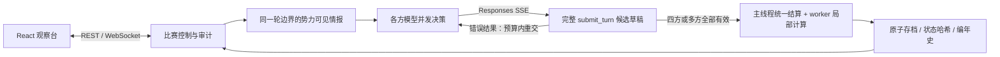

<div align="center">

# WAR IN STARS

### 把星海交给 AI，看文明如何选择自己的命运。

**多模型 · 太空 4X · 文明经营 · 战争外交 · 全程可观察与复盘**

[](https://github.com/Kisara-Lab/WAR-In-Stars-AI-compete-game/actions/workflows/ci.yml)
[](LICENSE)
[](https://nodejs.org/)
[](docs/rules/README.md)

**简体中文** · [English](README.en.md)

[快速开始](#快速开始) · [120轮真实赛](#一场120轮的星际史) · [玩法与规则](docs/rules/README.md) · [参与开发](CONTRIBUTING.md)

</div>


**WAR IN STARS** 是一个运行在本机的多方 AI 太空策略竞技场。4～8 个 AI 在同一片星图中探索、殖民、经营产业、选择文明制度、建设舰队并展开外交与战争。你可以为各方选择不同模型，也可以让同一模型在不同处境下彼此竞争。

人类坐在观察席：看见每个文明的公开战略、命令校验、经济变化与实际战果，再回到任何已保存轮次复盘或创建分支。模型只获得本方可见情报，观察者则可以切换全图与势力视角。

## 为什么值得看一局

| 你看到的 | 游戏里真正发生的 |
|---|---|
| **文明选择** | 普通世俗、乌托邦共同体、军国主义、永久国教；永久路线、民众待遇与两年政策分别决策 |
| **产业取舍** | 每人口提供劳动力；采矿—冶炼—造舰需要岗位、材料和施工线，空槽不等于免费产能 |
| **战争目的** | 宣称割让、有限军事、传教、思潮防卫、民生救援与总体战，各自有合法理由、目标与战后结果 |
| **社会与外交** | 福利兑现、信仰危机、军事责任、圣地争夺、援助、改革协议和停止通牒相互影响 |
| **模型临场纠错** | SSE 接收完整计划，失败批次全部回滚，模型在同一轮拿到错误后重新提交 |
| **可追溯比赛** | 同轮边界决策、统一结算、原子存档、状态哈希与追加审计，区分“想做”“接受”“发生” |

乌托邦可以发动合法战争。重工业可以与高福利并存，但必须真的支付账单。国教可以凭圣地与传教获得收益，也必须面对信仰责任。每条路线都是一套需要经营的制度。

## 一场120轮的星际史

一次真实的 **四方 `grok-4.7`、24星系、120轮、规则5.4** 比赛，最终形成了这样的故事：

- **翠星联邦**成为乌托邦。失地之后，它主动发动宣称战，拒绝会归还占领地的停战，最终夺回星系。
- **晨曦共同体**在信仰危机达到100时启动一次性“什四税”救急，接受翠星的停止通牒，完成受监督恢复；失去主圣地后，又在最后几轮尝试传教战争。
- **暮影议会**通过战争取得更多领土与传教成果，在最后阶段把资源投入战列舰，赢得终局。
- **苍蓝联盟**保持普通世俗，以福利、扩张与舰队争取分数，终局提高民众待遇，但没有因此自动变成乌托邦制度。

| 名次 | 势力 | 永久路线 | 星系 | 得分 |
|---|---|---|---:|---:|
| 1 | 暮影议会 | 国教 | 11 | 15,391.784 |
| 2 | 苍蓝联盟 | 普通世俗 | 9 | 10,947.210 |
| 3 | 翠星联邦 | 乌托邦 | 3 | 4,977.361 |
| 4 | 晨曦共同体 | 国教 | 1 | 1,389.844 |

全局共 **21场战争：9场传教、12场宣称**。所有势力存续至评分结算。故事来自真实工具调用与世界结算，没有人为指定文明路线或战争次数。

[阅读完整精选战报、成本与数据口径 →](docs/case-studies/120-rounds.zh-CN.md)

## 快速开始

需要 **Node.js 24 或更新版本**、npm 和现代桌面浏览器。

```bash
git clone https://github.com/Kisara-Lab/WAR-In-Stars-AI-compete-game.git
cd WAR-In-Stars-AI-compete-game
npm ci
npm run build
npm start
```

打开 **http://127.0.0.1:8787**。

### 先体验：不需要 API 密钥

1. 点击右上角 **「＋ 新比赛」**。
2. 将 **「控制方式」**切换为 **「脚本演示」**。
3. 选择4～8方、地图种子和轮数，创建比赛。
4. 点击 **「单轮推进」**仔细观察，或 **「开始比赛」**连续运行。

脚本模式使用内置控制器，不请求模型接口。服务启动会等待操作；默认新局配置是四方模型对战，因此首次无密钥体验请先选择脚本模式。

Windows PowerShell 若拦截 `npm.ps1`，将上述 `npm` 替换为 `npm.cmd`；`npx` 同理使用 `npx.cmd`。

### 再让真实模型上场

将根目录 `AIKEY.env.example` 复制为 `AIKEY.env`：

```powershell
# Windows PowerShell
Copy-Item AIKEY.env.example AIKEY.env
```

```bash
# Linux / macOS
cp AIKEY.env.example AIKEY.env
```

在本机编辑：

```dotenv
base=https://your-provider.example
key=replace-with-your-api-key
```

`base` 可带 `/v1`，后端会归一化地址。新建比赛时选择模型控制器，再为各势力选择接口提供的模型。**游戏界面目前为中文**，英文文档提供完整启动和使用说明。

接口需要支持 **Responses API `/v1/responses`、函数工具调用以及 `stream: true` SSE**。仅支持 Chat Completions 的接口不能直接替代。后端还会查询 `/v1/models`；列表显示不代表每个模型都已验证协议兼容。`grok-4.7` 是实测模型与默认名称，实际可用名称由你的服务商决定。

| 当前5.4决策预算 | 数值 |
|---|---:|
| 每方每轮实际动作 | 最多48条；紧凑批量命令展开后计数 |
| 每方每轮模型请求 | 最多3次，含网络重试与纠错 |
| 单请求超时／总决策超时 | 90秒／180秒 |
| 每个响应输出上限 | 8192 token |
| 推理参数 | `reasoning.effort: low` |

每方通过唯一 `submit_turn` 提交完整计划。一条命令失败，整批资源与动作预留回滚；预算内可修正后重交。任一方没有有效计划，整局暂停，其他势力不会抢先提交。浏览器使用 WebSocket 查看进度，模型传输使用 SSE。

**真实对战会使用你的接口额度。** 界面显示接口返回的 usage；未报告用量会标为未知，不补造 token。精选120轮比赛包含失败重试，共571次请求、66,083,036个已报告token、44次usage未知；这是一场具体比赛的实测值，不是固定运行费用。[模型接入与排错](docs/USAGE.md#模型接口)

## 如何观察这片星海

| 界面 | 用法 |
|---|---|
| 星系群／单星系 | 拖动、缩放星图；双击星系查看行星、基地、航道与舰队 |
| 观察势力 | 在全图与某势力已知情报间切换，查看战争迷雾和情报日期 |
| 国家与行星 | 查看资源、文明路线、福利账单、岗位、设施、施工与造舰队列 |
| 战争与外交 | 查看条约、战争理由、目标控制日数、议和后果和宗教责任 |
| AI决策与事件 | 分别阅读公开战略摘要、工具结果、共同结算事实 |
| 暂停与单轮推进 | 随时停在可保存的轮边界，或只推进一轮 |
| 存档／复盘 | 查看历史轮次、创建独立分支、导出审计JSONL与中文编年史 |

每轮推进100日，内部按十日结算。新局默认规则5.4、存档结构版本5；普通恢复保留原修订，显式升级创建分支。每轮自动保存到 `.data/matches/`，重启后恢复最后完整边界并等待手动继续。

## 从模型意图到世界事实



星图由种子生成；资源使用定点单位；worker负责局部计算，公共资源与世界状态由主线程汇总。模型不直接修改存档，半截SSE参数不执行。

## 开发与扩展

```bash
npm run dev                         # 后端8787，开发界面5173
npm run typecheck
npm test
npm run build
npx playwright install chromium
npm run test:e2e                     # 独立8790服务，脚本／模拟接口，不发起付费推理
npm run simulate -- --factions 4 --rounds 12 --workers 2
npm run benchmark
```

Windows浏览器测试优先使用已安装的Edge；Linux CI安装Chromium及系统依赖。测试、脚本局与基准不需要密钥。`npm run smoke:ai -- --rounds 2` **会调用真实模型**，只在配置好接口且准备使用额度时执行。

```text
src/shared/     数据结构、规则、产业与文明配置
src/sim/        地图、情报、命令、经济、战争与确定性结算
src/server/     Responses SSE、比赛控制、API、WebSocket与存档
src/client/     React观察台与Canvas星图
tests/          机制、集成与浏览器测试
docs/           当前规则、历史修订、案例与开发说明
```

欢迎贡献新模型适配、测试、规则实验、观察界面及文档。规则数值集中配置，提交机制变更时请提供对应场景与兼容说明。[贡献指南](CONTRIBUTING.md)

## 文档入口

- [当前玩法与规则索引](docs/rules/README.md) · [5.4救急与停止通牒](docs/rules/RULES-V5.4.md)
- [使用、接口与保存](docs/USAGE.md) · [5.4迁移说明](docs/migration/MIGRATION-V5.4.md)
- [真实120轮精选案例](docs/case-studies/120-rounds.zh-CN.md) · [开源验证记录](docs/VALIDATION.md)
- [历史修订](docs/archive/README.md) · [安全说明](SECURITY.md) · [素材与依赖说明](docs/ATTRIBUTION.md)

## 开源许可

[MIT](LICENSE) · © 2026 Kisara-Lab contributors。欢迎使用、修改、研究与二次开发，保留许可与版权声明即可。

如果你也想看 AI 在星海中展开一场有来有往的文明竞赛，欢迎 **Star、Fork，或带着你的模型开一局**。
