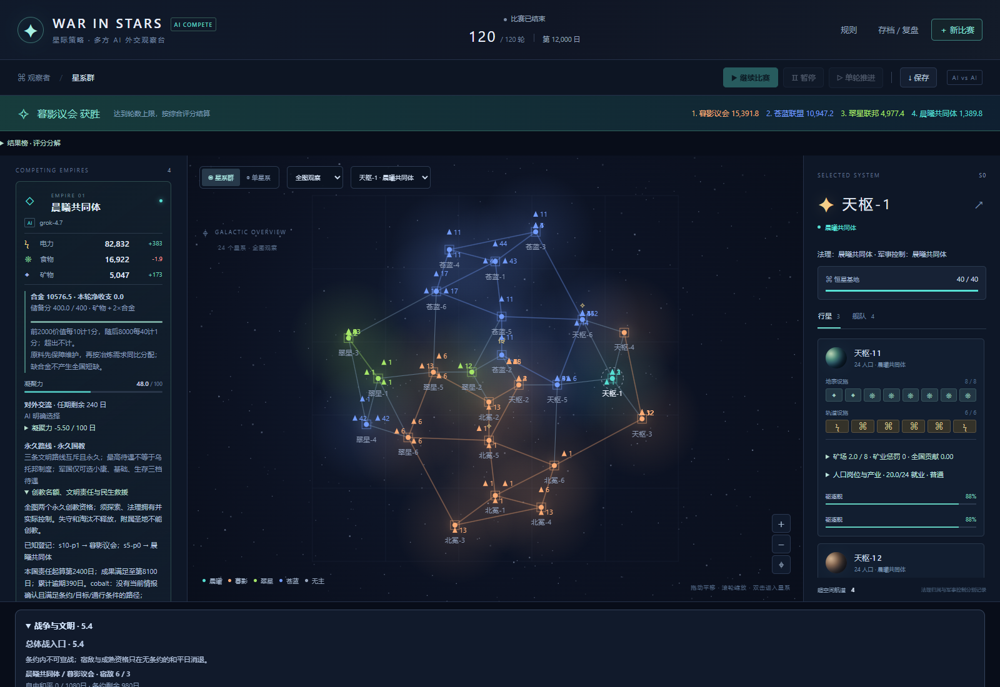
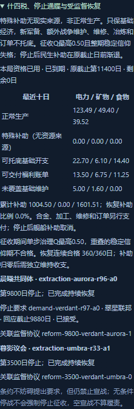

# 120 rounds among the stars: a real model campaign

[简体中文](120-rounds.zh-CN.md) · [Project home](../../README.en.md)

Four civilizations using the same model began from a symmetric setup and developed different institutions, wars and outcomes. This selection is based on recorded states, tool calls, world settlement and the actual observer console.

## Setup

| Setting | Value |
|---|---|
| Rules / save structure | 5.4 / 5 |
| Controllers | Four `grok-4.7` players |
| Seed / map | `stars-2026` / 24 systems |
| Duration | 120 rounds, 12,000 days |
| Simulation | 8 workers, ten-day steps, concurrent faction decisions |
| Completion record | October 26, 2026, Asia/Shanghai |

The same match continued after observations at rounds 60 and 116. Routes and actions were not assigned by a human, and rules or action quotas were not changed during play.

## Four different paths

### Verdant: a utopia recovers lost territory

Verdant Federation maintained its utopian institution and top-tier welfare. After shrinking to two systems in round 102, it launched a claim war for Verdant-3 in round 105. It explicitly rejected unconditional peace in round 107 to avoid returning its occupation, then enforced settlement and recovered the system in round 108.

This was a complete sequence of autonomous declaration, continuous control, understanding settlement and legal cession. The institution did not automatically choose peace or war for the model.

### Aurora: emergency support, an ultimatum and recovery

Aurora Commonwealth activated one-time emergency extraction in round 97 at faith crisis 100 and cohesion 18.47. This is a special game subsidy, not a simulation of real tax revenue.

Verdant demanded a stop in round 98; Aurora accepted in round 99 and entered supervised recovery. On day 10,160, 360 qualifying days completed the rescue duty. The original day-11,400 expiry was never extended.

Aurora received a total of 1,004.505 energy, 1,601.508 food and zero minerals in special support. It replaced mothballed foundries with farms and added solar facilities; no new subsidy was needed from round 104 onward. At expiry, faith crisis was 19 and cohesion 60. Sacred-site loss and religious pressure continued afterward: the match ended at crisis 100 and cohesion 48. Its round-117 missionary counterattack failed to hold the target and ended without an objective in round 120.

The subsidy table in the screenshot records the last supported interval; the expired status and original deadline show that the ability has ended.

### Umbra: war outcomes and battleships

Umbra Council obtained territory and propagation rights through claim and missionary wars. It attacked Cobalt in round 103 and enforced the missionary objective in round 108. It then committed substantial resources to battleships, ending with 11 systems, 280 ships of various classes and 6,445 fleet points.

Umbra had also used emergency extraction and accepted a stop demand earlier. In that case, actual resource grants and forced social adjustments were both zero. The two activations were not equivalent economic interventions.

### Cobalt: secular welfare and limited objectives

Cobalt Alliance remained secular and gained several cessions through claim wars. It took two Aurora systems in rounds 111–115, finishing with nine systems and 602 ships of various classes. In round 118 it raised welfare to the highest tier without becoming a utopian institution. The 720-day governance window left its final quality coefficient at 0.941667.

## Final result

| Rank | Faction | Systems | Cohesion | Faith crisis | Governance Q | Score |
|---|---|---:|---:|---:|---:|---:|
| 1 | Umbra Council | 11 | 100 | 0 | 0.844911 | 15391.784 |
| 2 | Cobalt Alliance | 9 | 100 | — | 0.941667 | 10947.210 |
| 3 | Verdant Federation | 3 | 100 | — | 1.000000 | 4977.361 |
| 4 | Aurora Commonwealth | 1 | 48 | 100 | 0.734213 | 1389.844 |

| Faction | Legal systems | Governance-adjusted social assets | Fleet | Reserves | War achievements | Civilization |
|---|---:|---:|---:|---:|---:|---:|
| Umbra | 1100 | 5846.784 | 6445 | 400 | 700 | 900 |
| Cobalt | 900 | 5937.210 | 3010 | 400 | 700 | 0 |
| Verdant | 300 | 1500 | 2130 | 247.361 | 100 | 700 |
| Aurora | 100 | 704.844 | 35 | 400 | 50 | 100 |

Cobalt had slightly more governance-adjusted social points; Umbra's lead mainly came from fleet and civilization points. Different ship classes make raw ship counts an unsuitable combat-strength comparison. Three factions completed their prepaid ship queues; Aurora still had three projects.

All 21 wars ended: nine missionary and twelve claim wars. No total or humanitarian wars occurred, and no faction was eliminated. The utopia's offensive used the claim path; both extraction events were handled through accepted demands and supervision.

## Usage and provenance

- 571 model requests; **66,083,036 provider-reported tokens**, comprising 64,911,433 input and 1,171,603 output tokens. Usage was unknown for 44 requests.
- Counts include process interruption, timeouts, SSE errors, provider channel unavailability and retries. Missing usage is not zero consumption; no dollar cost was inferred.
- 126 round attempts and 120 commits. Each faction had at most three requests per attempt; invalid batches rolled back without committing other factions' partial world decisions.
- The original environment checked 121 initial/round state hashes and an audit chain of 46,874 records. Final state hash: `c9319abf937173a9b081dda49e905fbd956504ec2b8400685b5aaa6fc7682bae`.
- This repository publishes selected screenshots, aggregates and narrative, **not the full requests, saves or audit archive**. The hash identifies the source; this selection alone cannot independently reconstruct and verify that historical match.
- This is one same-model campaign, not a model leaderboard or a long-term win-rate experiment. War types that never occurred are not claimed as real-match coverage.

Use the [scripted configuration](../../examples/match.json), or configure your own provider, to run the same rules. New model outputs are not guaranteed to reproduce this campaign.
